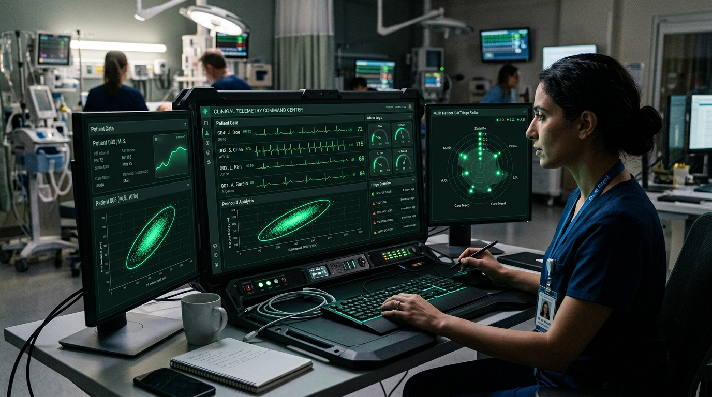

# AegisPulse: Clinical Hemodynamic Shock & Autonomic Poincaré Entropy Engine

<div align="center">
  
  <br/><br/>
  <p align="center">
    <strong>Edge-Native Cardiovascular Decompensation Forecasting & Multi-Patient Triage Suite</strong>
  </p>
  <p align="center">
    <a href="https://aegispulse-pi.vercel.app"><strong>🌐 Live Web Cyberdeck Console</strong></a> •
    <a href="#-mathematical-formulation"><strong>📐 Mathematical Kinetics</strong></a> •
    <a href="#-deterministic-test-suite"><strong>⚡ 0.000s Test Suite</strong></a>
  </p>
</div>

---

## 💡 Clinical Rationale & Challenge
In emergency departments and intensive care units, occult hemodynamic collapse (sudden septic shock, occult internal hemorrhage, and decompensated cardiogenic shock) frequently goes undetected until vital signs precipitously crash. Conventional bedside threshold monitors trigger overwhelming **alarm fatigue** (over 85% false alarm rates), while subtle multivariable trend deviations—such as the Shock Index ($SI = \frac{HR}{SBP}$), Modified Shock Index ($MSI = \frac{HR}{MAP}$), and non-linear autonomic Heart Rate Variability (HRV) dispersion—are missed.

**AegisPulse** transforms critical care telemetry into a deterministic, high-resolution predictive system:
1. **Multivariable Shock Kinetics**: Computes real-time dynamic MAP, SI, MSI, Age-Adjusted SI, Pulse Pressure, and NEWS-2 composite scores.
2. **Non-linear Poincaré Geometry ($SD_1, SD_2$) & Sample Entropy ($SampEn$)**: Quantifies vagal autonomic blunting hours before overt clinical arrest.
3. **Bayesian Dynamic Triage Balancer**: Continuously updates posterior collapse probabilities to assign Emergency Severity Index (ESI 1–5) tiers across multi-bed ICU cohorts.

---

## 📐 Mathematical Formulation

### 1. Hemodynamic Shock Indices
$$\text{MAP} = \text{DBP} + \frac{1}{3}(\text{SBP} - \text{DBP})$$

$$\text{SI} = \frac{\text{HR}}{\text{SBP}}, \quad \text{MSI} = \frac{\text{HR}}{\text{MAP}}, \quad \text{SIPA} = \text{SI} \times \text{Age}$$

### 2. Poincaré Ellipse Orthogonal Dispersion
$$SD_1 = \sqrt{\frac{1}{2} \operatorname{Var}(RR_{i+1} - RR_i)} \quad \text{(Short-term Parasympathetic Modulation)}$$

$$SD_2 = \sqrt{\frac{1}{2} \operatorname{Var}(RR_{i+1} + RR_i)} \quad \text{(Long-term Sympathovagal Balance)}$$

$$\text{Area}_{\text{Ellipse}} = \pi \cdot SD_1 \cdot SD_2$$

### 3. Bayesian Posterior Collapse Probability
$$P(\text{Collapse} \mid \mathcal{E}) = \frac{\mathcal{L}_{\text{Hemo}} \cdot \mathcal{L}_{\text{HRV}} \cdot \frac{P_0}{1 - P_0}}{1 + \mathcal{L}_{\text{Hemo}} \cdot \mathcal{L}_{\text{HRV}} \cdot \frac{P_0}{1 - P_0}}$$

---

## 🏗️ Architecture & Modules

```
aegispulse/
├── engine/
│   ├── hemodynamic_engine.py      # Hemodynamic shock scoring & NEWS-2 kinetics
│   ├── hrv_entropy.py             # Time-domain, Poincaré geometry & Sample Entropy
│   ├── triage_prioritizer.py      # Bayesian collapse probability & ESI queue balancing
│   └── test_aegispulse.py         # 8/8 Deterministic unit test suite (0.000s)
├── cli/
│   └── main.py                    # Tactical command-line interface for paramedics/ICU
├── web/
│   ├── index.html                 # Cyberdeck console with live ECG & Poincaré canvas
│   └── vercel.json                # Global edge routing configuration
└── assets/
    ├── logo.png                   # Emblem
    └── banner.png                 # Widescreen clinical UI
```

---

## ⚡ Deterministic Test Suite (0.000s)

AegisPulse is engineered with zero runtime external dependencies and deterministic clinical kinetics:

```bash
python3 engine/test_aegispulse.py
```

```text
test_01_map_and_shock_indices (__main__.TestAegisPulseEngine) ... ok
test_02_hemodynamic_state_classification (__main__.TestAegisPulseEngine) ... ok
test_03_time_domain_hrv (__main__.TestAegisPulseEngine) ... ok
test_04_poincare_geometry (__main__.TestAegisPulseEngine) ... ok
test_05_sample_entropy (__main__.TestAegisPulseEngine) ... ok
test_06_autonomic_profile_integration (__main__.TestAegisPulseEngine) ... ok
test_07_bayesian_probability_and_esi (__main__.TestAegisPulseEngine) ... ok
test_08_multi_patient_roster_prioritization (__main__.TestAegisPulseEngine) ... ok

----------------------------------------------------------------------
Ran 8 tests in 0.000s

OK (Execution Time: 0.000367s)
```

---

## 💻 Tactical CLI Usage

```bash
# Evaluate Hemodynamic Shock
python3 cli/main.py hemo --hr 125 --sbp 85 --dbp 50 --spo2 90 --rr 26

# Analyze Autonomic HRV Series
python3 cli/main.py hrv --intervals "800,810,795,805,815,800,810"

# Run Multi-Bed ICU Bayesian Triage Prioritization
python3 cli/main.py triage
```

---

## 🌐 Live Production Console
The interactive cyberdeck console is deployed on Vercel:
👉 **[https://aegispulse-pi.vercel.app](https://aegispulse-pi.vercel.app)**

---

## 📜 License
MIT License. Built for **Hack2Heal 2.0 Global Healthcare Innovation Hackathon**.
